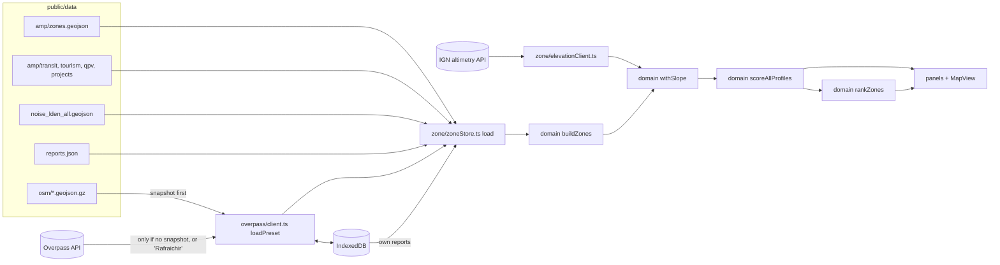

# Atlas MJSL: developer guide

This guide is for whoever picks up the code next. It explains what the app computes, how
the code is laid out, where the data comes from, and how to make the changes you are most
likely to be asked for. The user-facing description (in French) is
[`atlas/README.md`](../atlas/README.md). The research behind the method is in
[`doc/research/`](research/).

---

## 1. What the app does, in one paragraph

The **Matrice de Justice Spatiale Littorale (MJSL)** reads accessibility as six
dimensions (physical, sensory, cognitive, economic, social, political) rather than as a
checklist of norms. The Atlas applies it to **every zone of Marseille**: the 393 IRIS
(the smallest official statistical unit), trimmed to the land. For each zone it measures
about 25 **indicators** from open data (OpenStreetMap, the Metropole's open data portal,
the official noise map, IGN altitudes, citizens' reports), turns each into a **barrier**
between 0 and 1, averages them per **dimension**, and combines the dimensions into one
**score per profile** (a person in a wheelchair, a blind person, an allophone person, a
low-income person). The map colours the zones, a ranking lists the worst inhabited zones,
and a click on a zone shows every step of its calculation. **Nothing is typed in by
hand** except optional citizen reports, kept in the browser.

### Glossary

| Term | Meaning | In the code |
|---|---|---|
| Zone | One IRIS, the unit of all scoring | `Zone` in `domain/zone/types.ts` |
| Indicator | A number measured over a zone (e.g. benches per km of street) | `zone.values[key]`, `config.indicators[key]` |
| Barrier | An indicator mapped to 0 (no problem) .. 1 (total obstacle) | `BarrierResult` |
| Dimension | One of the six MJSL axes, D1..D6 | `Dimension`, `DIMENSIONS` in `domain/dimensions.ts` |
| Profile | A person type: weights over the six dimensions | `config.profiles` |
| Score | 0 (inaccessible) .. 1 (no obstacle), per zone and profile | `ZoneScore` |
| Source | Where a value came from: `osm`, `official`, `reported` | `ValueSource` |
| Evidence | An indicator (citizens' reports) that can only *add* to a barrier | `kind: "evidence"` |
| Preset | An Overpass query + id; the id also names its snapshot file | `OverpassPreset` |

**Two rules hold everywhere and must stay true:**

1. **Missing data is never 0.** An indicator with no basis in the data is left out of
   `zone.values`; every later step skips it. A dimension with no data is left out of the
   score and its weight is spread over the others.
2. **Colour is never the only cue** (WCAG 2.2 AA). Red zones are also dashed, report
   kinds have distinct shapes, every chart has text values, and the Tableau tab carries
   the same data as the map.

---

## 2. Repository layout

```
.
├── .github/workflows/static.yml   CI: test, build atlas/, publish atlas/dist on GitHub Pages
├── doc/
│   ├── DEVELOPER_GUIDE.md         this file
│   ├── SCORING_MATH.md            the score, formula by formula, with a worked example
│   └── research/                  the memoire's hand-over note (French)
└── atlas/                         the application (Vite + React + TypeScript + MapLibre)
    ├── index.html
    ├── package.json               scripts: dev, test, build, data:*
    ├── vite.config.ts
    ├── .env.example               optional Google geolocation key
    ├── data/raw/                  raw inputs read by scripts, never served (citizen reports)
    ├── scripts/                   one-off data preparation (Node), writes into public/data/
    ├── public/data/               every dataset the app loads at runtime (~11 MB, committed)
    │   ├── amp/                   zones, transit, tourism, QPV, projects (Metropole portal)
    │   ├── osm/                   OpenStreetMap snapshots, one .geojson.gz per preset
    │   ├── noise_lden_all.geojson official noise map
    │   └── reports.json           citizens' reports
    └── src/
        ├── main.tsx               React entry
        ├── domain/                PURE logic: no React, no DOM, no fetch. Fully unit-tested.
        │   ├── dimensions.ts      the six dimensions (key, D-code, label, colour)
        │   └── zone/
        │       ├── zone.config.json   ALL thresholds, weights, tag lists (the tuning file)
        │       ├── loadConfig.ts      validates the config, with plain-language errors
        │       ├── build.ts           datasets -> zones with indicator values (+ slope)
        │       ├── score.ts           values -> barriers -> dimension barriers -> score
        │       ├── dimensionScores.ts per-dimension scores over a set of zones
        │       ├── ranking.ts         priority zones and their "why"
        │       ├── toGeojson.ts       export for QGIS
        │       ├── ampData.ts         Metropole open data index
        │       ├── noiseMap.ts        noise band lookup
        │       ├── spatial.ts         SpatialGrid, PolygonIndex (point-in-polygon)
        │       ├── geo.ts             distances, coordKey, local projection
        │       ├── zoneGeometry.ts    area/centroid, representative point
        │       └── index.ts           the barrel: import the domain from here
        └── app/                   the browser app
            ├── App.tsx            page layout: sidebar, tabs (Carte / Tableau / Analyse)
            ├── state.ts           store #1: basemap, OSM overlay presets, status line
            ├── studyArea.ts       Marseille bbox, tiling of the city for Overpass
            ├── styles.css         design tokens and the few shared classes (.btn, .card...)
            ├── zone/              store #2 (zoneStore.ts) and every zone-related panel
            ├── map/               MapView, basemaps, OSM overlay glyphs
            ├── overpass/          OSM loading: snapshot -> cache -> Overpass mirrors
            ├── persistence/db.ts  the single IndexedDB opener
            ├── components/        generic panels: table, dashboard, charts, icons
            └── export/            zip / GeoJSON download
```

The split between `domain/` and `app/` is the main architectural rule: **the domain never
imports from the app**, never touches the network or the DOM, and takes the config as a
parameter. That is what makes the scoring testable in Node and reusable from the scripts.

---

## 3. Getting started

Requirements: **Node 22** (Vite 8 needs 20.19+; CI uses 22) and npm.

```bash
cd atlas
npm ci             # install exactly what package-lock.json says
npm run dev        # http://localhost:5173, hot reload
npm test           # vitest, ~1 s
npm run typecheck  # tsc --noEmit
npm run build      # typecheck + production bundle in atlas/dist
npm run preview    # serve dist/ locally
```

All the data is committed in `public/data/`, so the app runs straight after `npm ci`
with no network except map tiles and the IGN altitude service (slopes; cached in the
browser after the first load).

Optional: copy `.env.example` to `.env.local` and set `VITE_GOOGLE_GEOLOCATION_KEY` to
let "Me localiser" fall back to Google's geolocation when the browser cannot locate the
person. Without it the browser's own geolocation is used, which is enough in practice.
Note that a `VITE_*` value is embedded in the public bundle: restrict the key by HTTP
referrer in the Google Cloud console.

In development three handles are put on `window` for the console: `__store` (app store),
`__zones` (zone store) and `__map` (the MapLibre instance).

---

## 4. Architecture and data flow



### Start-up sequence (`zoneStore.load`)

1. In parallel: the OSM data of the whole city (48 street tiles + 12 "social" tiles),
   the Metropole files, the reports, the noise map.
2. The device's own reports are read from IndexedDB.
3. `recompute()` runs `buildZones` -> `withSlope` -> `scoreAllProfiles` for every zone
   and profile -> `rankZones`, and puts the result in the store. The UI is usable here.
4. `loadSlope()` fetches the altitudes of a 200 m grid from IGN (about 6,000 points in
   batches of 200, cached forever in IndexedDB), then calls `recompute()` again, so the
   slope indicator joins the scores a few seconds later.

`recompute()` is also called after a report is added or removed. It rebuilds everything
from the module-level `inputs` (the loaded datasets), so the map, the ranking, the table
and the inspector always agree. A full rebuild takes well under a second.

### The two stores (zustand)

* `app/state.ts` (`useAppStore`): basemap, the OSM overlay presets (load state,
  visibility), and the `status` line, which is an `aria-live` region: every long
  operation reports progress there in plain words.
* `app/zone/zoneStore.ts` (`useZoneStore`): zones, scores, ranking, selected profile and
  map layer, selection, report filters, own reports, the "place a report" mode, and the
  slope progress.

Components subscribe with selectors (`useZoneStore((s) => s.zones)`); non-React code
reads `useZoneStore.getState()`.

### Where OSM data comes from (`overpass/client.ts`)

For each preset, in order:

1. **Snapshot** `public/data/osm/<preset id>.geojson.gz` (made by `npm run data:osm`).
   This is what normally serves the app, so it does not depend on Overpass.
2. **IndexedDB cache** (`overpass` store), if younger than 7 days.
3. **Overpass**, trying three public mirrors with a 70 s timeout each.
4. A **stale cache** if every mirror failed.

"Rafraichir depuis Overpass" skips steps 1 and 2. Concurrent calls for the same preset
share one request.

There are two families of presets:

* `overpass/zonePreset.ts`: the data behind the scores (`walkways_mjsl5_rXcY`,
  `social_mjsl2_rXcY`). The ids are historical but **must not change**: they name the
  snapshot files.
* `overpass/presets.ts`: `OVERPASS_PRESETS`, the "Indices OSM" overlay drawn as glyphs
  on the map (steps, lifts, kerbs, tactile paving) in the Vieux-Port to Corniche corridor.

### Browser storage (`persistence/db.ts`)

One IndexedDB database, `mjsl-atlas`, version 5, two stores: `overpass` (cached Overpass
answers and the altitudes) and `reports` (citizen reports added on this device). Older
stores from earlier versions are left alone on purpose. Always open the database through
`openDb()`: opening it elsewhere at another version throws a `VersionError`.

---

## 5. The scoring model

The full derivation, with every formula and a worked example, is in
[`SCORING_MATH.md`](SCORING_MATH.md); this section is the summary.

Everything below is parameterised by `src/domain/zone/zone.config.json`, which is
validated at start-up by `loadConfig.ts`: a mistake there stops the app with a message
that names the field and says what is expected. Keys starting with `_` are comments.

### 5.1 Indicators (`build.ts`)

For each zone, `buildZones` counts and measures what falls inside it. Densities are **per
km of street** (only streets in `autoData.streetHighways`, hiking trails excluded), and
are left out when the zone has less than `autoData.minStreetKm` of street. Point data
(OSM objects, reports, transit stops) is assigned to the zone containing it; area data
(noise, participation perimeters) is sampled on a 100 m lattice; distances (information
centres, civic places) are measured from the zone's centroid.

| Dimension | Indicators (config key) | Source |
|---|---|---|
| D1 physical | `steps`, `slope`, `surface`, `rest` (benches), `transit` (modes), `parkingReports`, `narrowReports`, `worksReports` | OSM, IGN, Metropole, reports |
| D2 sensory | `noise`, `crossings` (unequipped share), `glare`, `signage`, `lighting` | official noise map, OSM |
| D3 cognitive | `legibility` (sinuosity), `landmarks`, `infoCentres` (distance) | OSM, Metropole |
| D4 economic | `publicPrivate`, `freeServices`, `furnitureReports` | OSM, reports |
| D5 social | `poverty`, `shelter`, `surveillance`, `coPresence`, `activities` | INSEE via Metropole, OSM |
| D6 political | `participation` (share outside QPV/project perimeters), `civic` (distance) | Metropole, OSM |

Each value records its source in `zone.sources`; raw counts go to `zone.counts` for display.

### 5.2 Value -> barrier (`score.ts: computeBarriers`)

* `linear`: a straight line from `noProblemAt` (barrier 0) to `totalObstacleAt` (barrier 1),
  clamped. It works in both directions (more benches is better, more steps is worse).
* `share`: the value already is a 0..1 barrier.
* `evidence`: linear, but see below.

### 5.3 Barriers -> dimension barrier

The ordinary indicators of a dimension are **averaged**. Evidence indicators (the
citizens' reports) then **compound** on top:

```
dimensionBarrier = 1 - (1 - mean(ordinary)) * Π (1 - evidence_i)
```

so a report can only make a dimension worse, never dilute an obstacle the open data shows.

### 5.4 Dimension barriers -> score

For profile *p* with weights *w_d* over the dimensions *d* that have data:

```
score = Π_d (1 - min(barrier_d, cap)) ^ (w_d / Σ w_d)
```

A weighted geometric product: barriers **compound** ("elles ne s'additionnent pas : elles
composent un systeme", in the memoire's words), so one very bad dimension drags the score
down. `scoring.dimensionBarrierCap` (0.9) stops a single dimension at its worst from
forcing the score to exactly 0. The score is then classed red / orange / green with
`classes.redBelow` / `classes.orangeBelow`; `none` means no dimension had data.

### 5.5 Ranking (`ranking.ts`)

Zones of type `habitat` with a score, sorted lowest first. Each carries its three worst
indicators and a one-line summary. Business areas, parks and the Calanques are drawn but
not ranked: the priority list is about where people live.

The per-dimension scores on the map layers and in the dashboard are `1 - dimensionBarrier`
and do **not** depend on the profile. The profile only decides each dimension's weight.

---

## 6. Data: sources, files, refresh

| File in `public/data/` | Made by | Source and licence |
|---|---|---|
| `amp/zones.geojson` | `npm run data:zones` (`fetchAmp.mjs` then `clipZones.mjs`) | IRIS 2024 + INSEE income/poverty 2014, arrondissement contours; Metropole AMP, Licence Ouverte 2.0 |
| `amp/transit.json`, `tourism.json`, `qpv.geojson`, `projects.geojson` | `npm run data:zones` (or `data:amp`) | Metropole AMP, Licence Ouverte 2.0 |
| `noise_lden_all.geojson` | `npm run data:noise` | Bruit multiexposition Lden, Metropole AMP, Licence Ouverte 2.0 |
| `reports.json` | `npm run data:reports` from `data/raw/signalements_voirie_marseille.geojson` | "Galere pietons" (Marsactu). **Reuse licence still to be confirmed.** |
| `osm/*.geojson.gz` | `npm run data:osm` (10-30 min, resumable; `-- --force` to redo all) | OpenStreetMap, ODbL |

The scripts are idempotent and only write into `public/data/`. Re-run one after a source
updates, check the console summary, run the app, and commit the regenerated files.

`data:osm` keeps only the tags listed in `KEEP_TAGS` (`overpass/snapshot.ts`) to keep the
files small: **a tag the scoring starts to read must be added there**, and the snapshots
regenerated, or it will silently be missing.

All attributions are shown on the map (`MapView.tsx`) and written into the export zip
(`export/download.ts`). Keep both lists in step when a source is added.

---

## 7. Recipes

### Change a threshold, a weight, or a colour class
Edit `zone.config.json`, reload. No code change. The tests check that the shipped config
is valid and that each profile's weights add up to 1.

### Add a profile
Copy a block under `profiles` with a new key, give it a `label` and `weights` that add up
to 1. It appears in the profile selector, the scores, the export (`score_<key>`) and the
inspector automatically.

### Add an indicator
1. **Config**: add an entry under `indicators` with `label`, `unit`, `dimension`, `kind`
   and, for `linear`/`evidence`, `noProblemAt` and `totalObstacleAt`.
2. **Measure it** in `buildZones` (`build.ts`): accumulate what you need in `Acc`, then
   call `set("<key>", value, source)` in the "Assemble the zones" part. Leave it unset
   (never 0) when the data cannot support it.
3. **If it reads new OSM tags or objects**: add them to the Overpass query in
   `zonePreset.ts` and to `KEEP_TAGS`, then run `npm run data:osm -- --force`.
4. **Test** it in `domain/zone/__tests__/zone.test.ts` with a small hand-made zone.

The inspector, the coverage list ("Donnees disponibles par indicateur"), the dimension
bars and the export pick it up from the config.

### Add a dataset (another open-data file)
Write a script in `scripts/` that writes into `public/data/`, add an `npm run data:*`
entry, load it in `zoneStore.load` with `getJson` (optional files return `undefined`,
never throw), pass it into `buildZones`, and add its attribution (see §6).

### Add a citizen report type
Add the wording to `REPORT_TYPE_OPTIONS` (`zone/reportStyle.ts`) and make sure a word of
it appears in one of the lists under `reports` in the config (matching ignores case and
accents). A brand-new *kind* needs a `ReportKind` member (`types.ts`), a config list, a
`REPORT_STYLE` entry (label, shape, colour), and an evidence indicator in the config +
`build.ts`.

### Add an "Indices OSM" overlay
Add a preset to `OVERPASS_PRESETS` (`overpass/presets.ts`). It gets a source, a layer, a
panel entry and a snapshot automatically; give its features a kind in `osmKind` and a
glyph in `OSM_STYLE` (`map/osmStyle.ts`) if they need their own symbol.

### Change the study area
`STUDY_AREA` in `app/studyArea.ts`, **and** the `BBOX` constants at the top of
`scripts/fetchAmp.mjs` and `scripts/fetchNoise.mjs`, then regenerate every dataset.

---

## 8. Testing

`npm test` runs Vitest in Node (`src/**/*.test.ts`):

* `domain/zone/__tests__/zone.test.ts`: config validation, barriers, the product score,
  missing-data rules, evidence compounding, building zones from small fixtures, noise and
  participation sampling, slope, ranking, export.
* `app/zone/*.test.ts`: map colouring and classes, report symbols and type matching,
  geolocation (with an injected `fetch`).
* `app/overpass/snapshot.test.ts`: tag trimming, gzip round trip, fallbacks.

Put new pure logic in `domain/` and test it there. Code that needs the DOM, MapLibre or
IndexedDB is kept thin and checked in the running app.

---

## 9. Deployment

Every push to `main` runs `.github/workflows/static.yml`: `npm ci`, `npm test`,
`npm run build`, then publishes `atlas/dist` to GitHub Pages. The build uses a relative
base (`./`, see `vite.config.ts`), so `dist/` works under `/<repo>/` or any other path,
and every runtime URL is built from `import.meta.env.BASE_URL`. The repository's Pages
source must be set to **GitHub Actions** (Settings -> Pages).

To host elsewhere, serve `atlas/dist` as static files. The server must send `.mjs` with
a JavaScript MIME type (MapLibre's worker): Python's `http.server` on Windows does not,
and the map then stays blank.

---

## 10. Conventions

* **Code and comments in English, interface in French.** Interface strings are written
  without accents in most places (an early choice), except the citizen-report types,
  which keep the data's own wording so new reports match the existing ones.
* Comments say **why**, not what. Many explain a non-obvious bug they prevent: read them
  before "simplifying" the code they sit on.
* TypeScript is strict with `noUncheckedIndexedAccess`; prefer a guard to `!` unless the
  index is provably valid.
* Accessibility is a requirement, not polish: keep the `aria-live` status, the table
  alternative, visible focus, 24 px minimum targets, reduced-motion support, and the
  "never colour alone" rule.
* Shared styles live in `app/styles.css` as a handful of classes (`.btn`, `.card`,
  `.callout-*`, `.stat-tile`...) over CSS variables; everything else is Tailwind utilities.

---

## 11. Pitfalls already met

* **MapLibre worker.** The bundler does not copy `maplibre-gl-worker.mjs`; a small plugin
  in `vite.config.ts` does. In dev, `maplibre-gl` is excluded from pre-bundling, or
  Firefox refuses the worker.
* **React StrictMode** runs effects twice in dev. The map init and the basemap swap are
  written for it (see the comments in `MapView.tsx`); Overpass calls are de-duplicated in
  `client.ts`.
* **Basemap swap** drops every custom source, layer and image. `syncZoneLayers` and
  `syncPresetLayers` are idempotent and re-add them; keep new layers in that pattern.
* **Overpass is a free, volunteer-run service.** Keep the pauses and one-at-a-time
  loading; do not add start-up queries that bypass the snapshots.
* **IGN altimetry**: about 5 requests/s and a few hundred points per request; hence the
  batching and pause in `elevationClient.ts`.
* **A hidden browser tab** pauses MapLibre's rendering, so automated checks of the map in
  a background tab see an empty map even when everything works.

---

## 12. Known limitations and open work

* **Thresholds are starting values**, calibrated against the spread of Marseille's zones
  (the config's comments mention 336 zones, before the move to all 393 IRIS and before the
  slope indicator worked). They say "worse than most of the city", not "unusable".
  Re-calibrate with the field work.
* Poverty describes the zone, not its streets; the cognitive, social and political
  indicators are proxies built from open data. The reports are a sample, not a census.
* The reuse licence of the "Galere pietons" reports is still to be confirmed before any
  public deployment.
* The JS bundle is about 1.4 MB, mostly MapLibre and JSZip; the build warns about chunk
  size. Lazy-loading JSZip and the dashboard would help if load time matters.
* `@types/react` is still on 18 while React is 19; it typechecks, but align them when
  upgrading dependencies.
